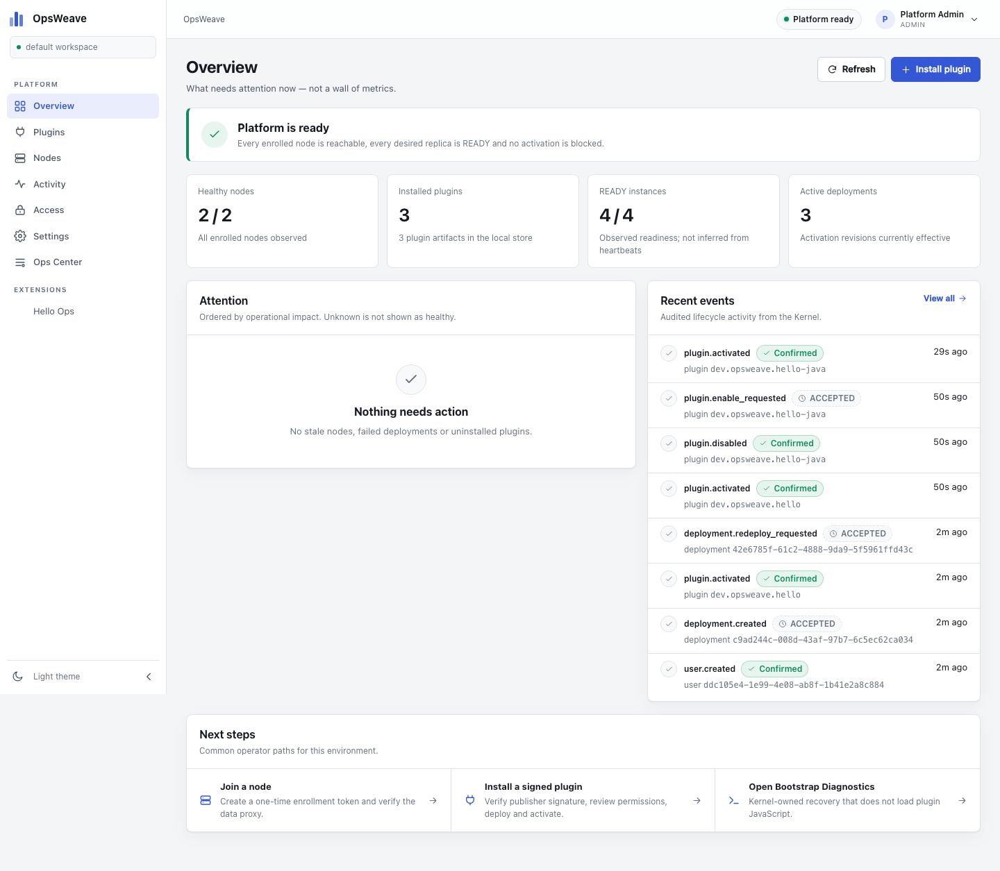

# OpsWeave 0.0.1 — Platform Foundation

A working implementation of the OpsWeave 1.1.0 architecture baseline: a Rust/Axum Kernel, PostgreSQL control plane, two independently enrolled Node Runtimes, signed full-stack plugin packages, OCI Runtime v1 workloads in Java 21 / Go / TypeScript, a React Web Shell with dynamically loaded remote extensions, and a recovery CLI.

> **Status:** internal experimental implementation. It is **not** a production HA or multi-tenant product. Real Linux amd64 nodes, Rootless Docker, mTLS, image signature attestations and three physical machines are **NOT_RUN** here. See [Implementation status](docs/IMPLEMENTATION_STATUS.md) and [acceptance evidence](docs/acceptance/EVIDENCE.md).



## What is implemented

| Area | Delivered |
|---|---|
| Kernel | Rust/Axum/Tokio, SQLx/PostgreSQL, RBAC sessions with CSRF, audit, operation receipts, publisher trust store |
| Package security | ZIP limits and path/symlink/bomb checks, canonical payload index, Ed25519 signature over artifact **and manifest** digest, immutable id+version, content-addressed static asset store |
| Lifecycle | Upload → VERIFIED/STAGED → deploy → READY → activate → disable/enable → upgrade → rollback → uninstall (data retained) |
| Nodes | one-time enrollment token, hashed node credential, heartbeat/desired-state pull, two node runtimes, revocation, UNREACHABLE not STOPPED |
| OCI | Rootless-Docker-reference **Docker CLI adapter** with digest-only pulls, read-only rootfs, cap-drop ALL, no-new-privileges, CPU/memory/PID limits, loopback-only published ports, health probes |
| Runtime v1 | `info`, live/ready/startup, request-id, language-neutral HTTP/JSON; real Java 21 Spring Boot, Go and Node/TypeScript images |
| Gateway | activation-revision-aware routes, READY+reachable filtering, API-prefix enforcement, timeout, idempotent GET retry, caller context overwritten server-side |
| Web Shell | React/TypeScript, responsive 390/1024/1440 light/dark, dynamic UMD remote loading with host React, route/nav contributions, error isolation without Shell rebuild |
| Ops Center | official system plugin with host-owned node/instance/recovery screens |
| Diagnostics | Kernel `/livez`, `/readyz`, `/api/v1/diagnostics`, server-rendered `/bootstrap`, `opsctl status/doctor/nodes/plugins` |
| Logs | bounded Node ring buffer, signed opaque cursors, SSE `log/gap/status/heartbeat`, authorization and filters |
| Contracts | Manifest v1.1, runtime info, deployment, node observation, log event, asset index + generated bundle checks |

## Quick start (local macOS/Linux reference)

Prerequisites: Rust 1.90+, Node 22 + pnpm, Docker Engine/Desktop, PostgreSQL 17, `go` and `mvn` only for rebuilding plugin images.

```bash
# 1. Start PostgreSQL and the local OCI registry (or use your local PG)
docker compose -f deployments/local/compose.yaml up -d postgres registry

# 2. Build Kernel, Node, CLI and Web Shell
make build
make web

# 3. Build the three plugin images, push digests to :5001, and sign bundles
scripts/build-plugins.sh

# 4. Reset local state, start Kernel + 2 Nodes, upload/deploy/activate all plugins
BUILD=0 scripts/demo_up.sh
```

Open <http://127.0.0.1:18181>. The bootstrap admin is `admin@opsweave.local` / `OpsWeave!2026` in the local demo only. Change it in any shared environment.

### Reproduce the acceptance checks

```bash
tests/acceptance/e2e_platform.sh
tests/acceptance/two_node_failover.sh
tests/acceptance/kernel_restart.sh
tests/acceptance/node_revocation.sh
tests/acceptance/node_quarantine.sh   # destructive: revokes node-a; reset afterwards
tests/acceptance/node_lease.sh        # destructive: partitions Kernel; reset afterwards
tests/acceptance/auth_limits.sh
tests/acceptance/publisher_revocation.sh
tests/acceptance/endpoint_policy.sh
tests/acceptance/container_security.sh
tests/contract/run_conformance.sh
python3 tests/contract/validate_contracts.py
pnpm --filter @opsweave/ui-tests test
```

## Architecture

```text
Browser ── TLS ingress ── React Shell (signed remote extensions)
   │                              │ authorized same-origin API
   └───────────────┬──────────────┘
                   ▼
        Rust Kernel (Axum/Tokio)
        IAM · Registry · Lifecycle · Capability · Reconciler
        Gateway · Bootstrap Diagnostics · Logs cursor broker
                   │
        PostgreSQL control-plane truth
        Desired · Activation revisions · Audit · Receipts
             │ outbound authenticated control pull
      ┌──────┴───────┐
      ▼              ▼
  Node Runtime A  Node Runtime B
  Docker adapter  Docker adapter
      │              │
  OCI plugin      OCI plugin
  instances       instances
```

The Kernel is one process and one PostgreSQL database; Nodes initiate heartbeat/desired-state traffic and own their local container observations. PostgreSQL is the source of truth for desired state; Node observations are authenticated facts with an expiry, never the registry.

## Repository map

```text
apps/kernel/             Rust Kernel: auth, packages, lifecycle, reconciler, gateway, logs, diagnostics
apps/node/               Rust Node Runtime: enrollment, Docker CLI adapter, proxy, logs, metrics
apps/opsctl/             opsctl recovery + bundle/signing CLI
apps/platform-web/       React Shell + design system + dynamic extension host
plugins/hello-ops/       TypeScript full-stack plugin (web remote + OCI backend)
plugins/hello-go/        Go Runtime v1 backend
plugins/hello-java/      Java 21 Spring Boot Runtime v1 backend
crates/contracts/        Shared wire types and manifest validation
crates/bundle/           ZIP safety, canonical payload index, Ed25519 signing/verification
contracts/               Frozen schemas, OpenAPI drafts and examples
docs/blueprint/          OpsWeave 1.1.0 design baseline, rules, skills, templates
docs/acceptance/         Honest evidence matrix and NOT_RUN items
deployments/             Local compose and Linux systemd reference units
tests/                   Contract, acceptance, runtime conformance and Playwright UI tests
```

## Security model in this implementation

- User sessions are HttpOnly, SameSite=Strict cookies plus CSRF tokens; bearer sessions are supported for `opsctl`. Passwords use Argon2id.
- Node credentials are one-time enrolled with atomic token consumption, stored hashed in PostgreSQL, locally stored `0600`, revocable. Data proxy uses a separate node data token that is rotated on revoke; a rejected credential or expired lease quarantines the Runtime and stops its workloads.
- Plugin backend images are **pulled by digest**; tags are rejected. Docker image *signature* attestation is not implemented (NOT_RUN); registry content digest is verified.
- Bundles require a trusted publisher, recomputed payload digest, and a detached Ed25519 signature covering both the artifact digest and canonical manifest digest.
- Containers run read-only, forced to numeric non-root UID 65532, cap-drop ALL, no-new-privileges, CPU/memory/PID limits, and only loopback-published ports. The Docker socket is never mounted into a plugin. Signed Remote Extensions use a trusted-publisher same-origin model; manifest permissions are review metadata, not an OS sandbox.
- Gateway strips browser identity headers and sets caller context itself. UI visibility is never treated as authorization.

### Known deviations / not delivered in 0.0.1

- **mTLS** between Kernel and Node is not implemented in code; the reference transport is HTTPS-capable bearer authentication on a private network. This is a release blocker for production and is recorded as `NOT_RUN`.
- No OCI image **signature** verification (only digest verification), no SBOM/vulnerability gate automation.
- No data migration engine; rollback is binary/route rollback only. A manifest that requires an incompatible migration must be blocked manually.
- The two-node validation runs two Node Runtime processes on one macOS host and one Docker Desktop daemon; real Linux amd64 + Rootless Docker + three machines are NOT_RUN.
- Java full-stack UI, old-tab compatibility window, backpressure/flood tests, multi-Kernel HA, NAT relay and historical log search are out of 0.0.1 scope.

## Documentation

- [Implementation status and gates](docs/IMPLEMENTATION_STATUS.md)
- [Acceptance evidence](docs/acceptance/EVIDENCE.md)
- [Operations runbook](docs/RUNBOOK.md)
- [API surface](docs/API.md)
- [Blueprint reference](docs/blueprint/README.md)
- [Security policy](SECURITY.md)
