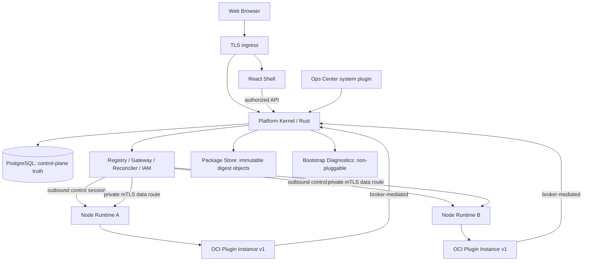

# 总体架构与不可变边界

## 逻辑拓扑



> 图中两条关键路径独立：Node 主动建立控制连接；Gateway 到 Node 数据代理需要内网可路由 + 双向认证。**0.0.1 不承诺纯 NAT 隧道支持**。跨 NAT 需要后续 Relay/Overlay 适配器。插件不得直接公开服务端口。

## ADR 核心决策
- **Rust Kernel（Axum/Tokio/SQLx）**：单进程模块化单体。数据库 PostgreSQL 一套，业务插件通过可版本化 API 交互。不是微服务矩阵。
- **Linux Node Runtime + OCI 容器适配器**：多语言后端统一发布为 OCI 镜像；Node 服务通过受控 OCI 运行时部署，无网页/API 直通 Docker Socket。选择容器是为了资源限制和进程隔离；0.0.1 只实现一种实际引擎适配器。
- **React + TypeScript Web Shell**：共享 Design System、认证与导航；可信签名插件才允许动态加载远程 JS；前端 Module Federation 作为可替换实现适配层，API 不绑定具体 Bundler。
- **协议优先于 SDK**：Manifest/Capability/Deployment/Node/LogCursor 用 JSON Schema + HTTP/OpenAPI；Node 控制流可按团队能力选用 gRPC/mTLS，但契约与传输严格隔离。
- **Registry + Desired State in PG**：节点通过 reconciliation 执行；不能在收到“start 成功”后就把插件设置成 Ready。
- **官方系统插件 Ops Center**：面板可插拔，但平台最小诊断/恢复必须留在 Kernel。
- **Plugin Data Owns Its Schema**：跨插件必须走 Capability API，不可以 SELECT 其它插件内部表。

## 项目组织（推荐）
```text
opsweave/
  apps/platform-api/             Rust: Kernel API + Gateway + Reconciler + Bootstrap Diagnostics
  apps/platform-node/            Rust: Enrollment + Supervisor + Metrics + Log Stream
  apps/platform-web/             React Host: shell and extensions
  apps/opsctl/                   Rust CLI: admin recovery + plugin developer commands
  crates/{kernel-domain,registry,lifecycle,auth,gateway,deployment,protocol}/
  packages/{web-sdk,ui,contracts,plugin-build}/
  plugins/{hello-ops,ops-center}/
  contracts/{schema,openapi,examples}/
  deployments/{local,two-node}/
  tests/{contract,integration,system,fault-injection,ui}/
  docs/ rules/ skills/ plan/ scripts/
```

## 内部 Kernel 模块职责
| 模块 | 拥有什么 | 不能拥有 |
|---|---|---|
| Identity/Policy | Principal、ResourceRef、权限决策、租户/环境范围 | 业务 Data Catalog 对象 |
| Package Registry | 签名、摘要、已安装/可用制品、元数据 | 执行任意上传代码 |
| Lifecycle | 安装事务、依赖验证、发布状态机、回滚决策 | 插件私有业务操作 |
| Capability Registry | 版本化接口、提供者/消费者、路由快照 | 对调用者直接暴露私网地址 |
| Deployment/Reconciler | Desired/Observed/Effective、代次与节点资源 | 远程执行任意 Shell |
| Gateway | 用户鉴权、实例身份、路由选择、超时/限流/审计 | 依赖插件私有 DB 表 |
| Bootstrap Diagnostics | 自身 health、节点/实例/注册表最小只读信息、受控恢复 | 生产原始客户日志大批量检索 |
| Job Protocol (reserved) | ID、Lease/Fencing 语义契约 | 0.0.1 通用工作流执行引擎 |

## 部署约束
- 0.0.1 三台机器实验：Server K = Kernel + PostgreSQL + TLS ingress；Server A/B = Linux Node Runtime + OCI runtime；可信私网可双向路由。
- Node 经过审批和短期注册令牌注册，控制通道 Node 主动连 Kernel；Kernel 到 Node 的私有 mTLS 数据代理仅暴露受控插件路由。
- Server K 是单点故障，PostgreSQL 不是 HA；该阶段只能称“分布式插件部署”，**不能称控制平面高可用**。
- 0.0.2 Data Catalog/Data Integration 可以是两个独立插件，使用相同 Kernel 与数据库集群的逻辑分区和授权。

## 排除项
不自行构建容器调度器、不实现通用 service mesh、不可执行用户任意 DAG、不用 Rust dylib 注入、0.0.1 无远程第三方不可信 JS 商店、0.0.1 无多主 Kernel/K8s Operator。

## 2026-10-22 架构修订：OCI 多语言插件（优先级高于上文模糊选型）
- 生产后端 = OCI Image@Digest；参考宿主适配器固定 Rootless Docker Engine（Linux amd64），Node Systemd 守护进程独占管理 socket；其他 OCI adapter 以后另立 ADR。
- Java/Go/TypeScript/Rust/Python 插件只实现语言无关 HTTP/JSON Runtime v1；SDK 非准入条件。真实 0.0.1 conformance 必跑 Java/Go/TS。
- 前端 Remote 静态资源和后端容器镜像独立发行，通过签名的 Manifest 1.1 绑定，Kernel/Shell 只读不可变静态资产与 Gateway 生效路由；不要求业务 UI 容器。
- 下钻设计：[Runtime](20-language-agnostic-plugin-runtime.md) · [Artifacts](21-oci-artifacts-and-signing.md) · [Topology](22-oci-deployment-and-topology.md) · [Frontend](ui/05-plugin-dev-build-deploy-ui.md)。
