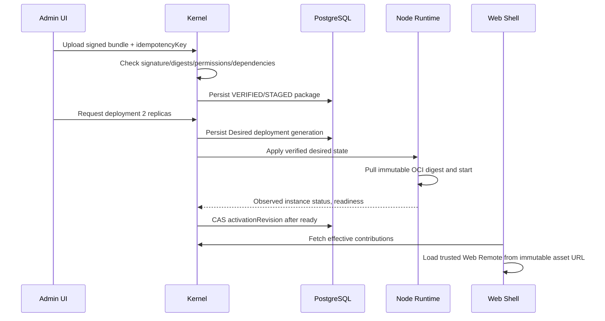
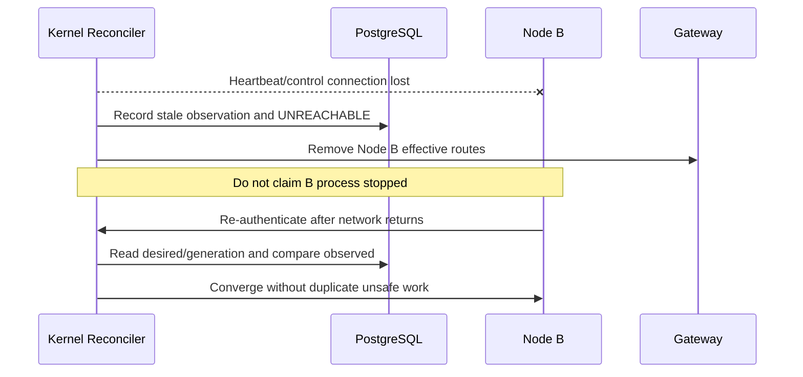

# 核心时序图（实现时按实际传输协议补充）

## A. 全栈插件安装


## B. Network partition


## C. 实时日志
```mermaid
sequenceDiagram
 participant U as Web
 participant K as Kernel Gateway
 participant N as Node Runtime
 U->>K: GET /instances/id/logs/live?cursor=X
 K->>K: Session + resource permission check
 K->>N: Authorized scoped tail stream
 N-->>K: bounded events + epoch/sequence
 K-->>U: SSE log id=opaque-cursor
 Note over N,U: rotation/overflow emits GAP; no fabricated continuity
```
